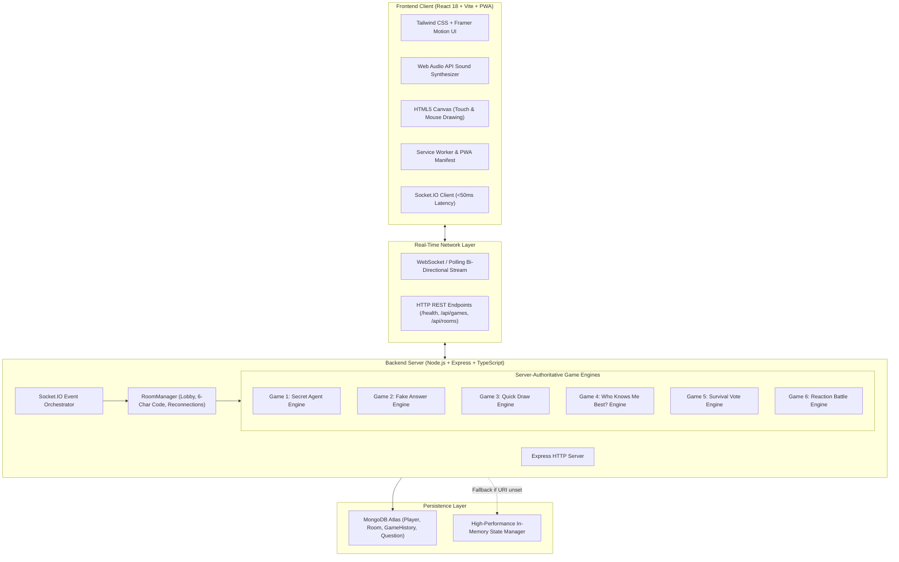
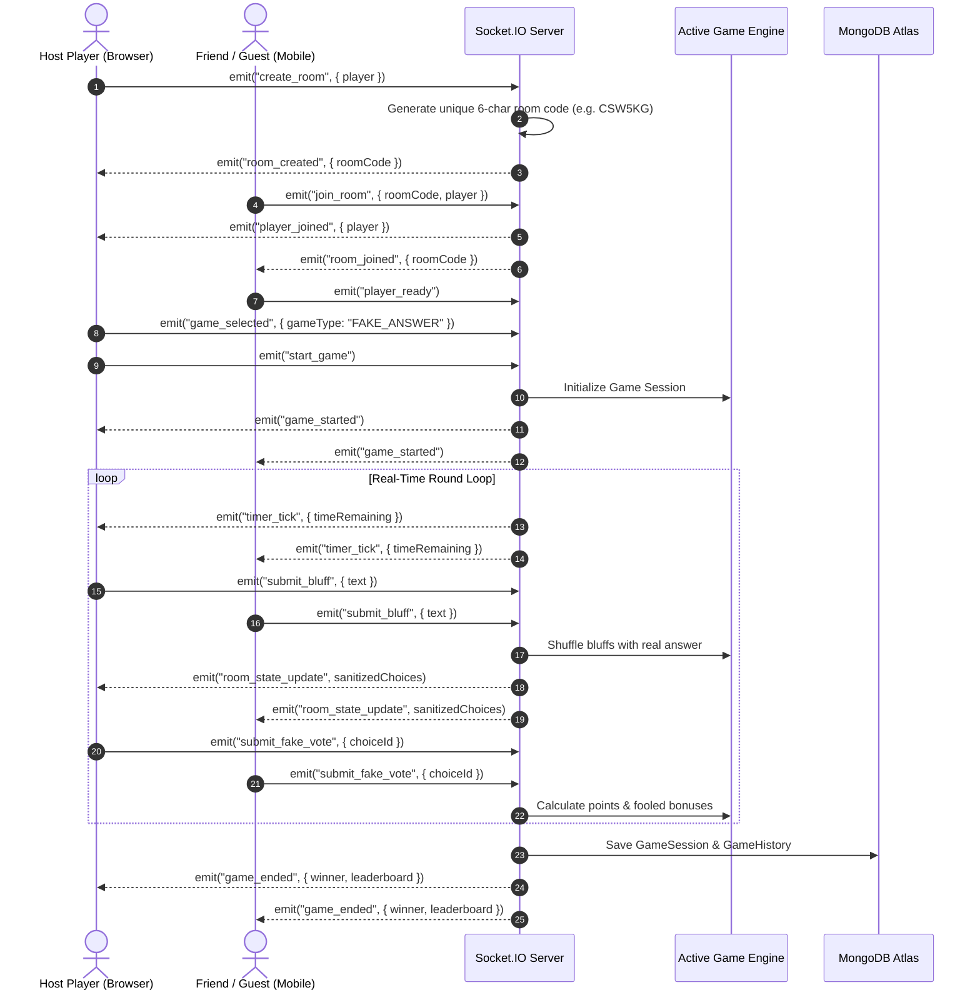

<div align="center">

# ⚡ CHAOS CLUB
### *Less scrolling. More chaos.*

**A modern, responsive, real-time multiplayer party gaming web platform.**

[](https://www.typescriptlang.org/)
[](https://reactjs.org/)
[](https://vitejs.dev/)
[](https://tailwindcss.com/)
[](https://socket.io/)
[](https://nodejs.org/)
[](https://expressjs.com/)
[](https://www.mongodb.com/atlas)
[](https://web.dev/progressive-web-apps/)
[](https://opensource.org/licenses/MIT)

<p align="center">
  <a href="#-system-architecture">Architecture</a> •
  <a href="#-the-six-mini-games">Mini-Games</a> •
  <a href="#-tech-stack">Tech Stack</a> •
  <a href="#-quick-start">Quick Start</a> •
  <a href="#-socketio-events">API Events</a> •
  <a href="#-deployment">Deployment</a>
</p>

</div>

---

## 📖 Overview

**CHAOS CLUB** is an all-in-one multiplayer party web platform built for high-energy game nights with friends. Players can generate a private room in seconds, invite friends using a **6-character room code** or direct share link, and battle across **six distinct mini-games** in real time.

- **Zero account registration required:** Jump in with an avatar, custom color, and nickname.
- **Server-authoritative state:** Timers, scores, and bluff verifications are strictly computed on the backend to prevent cheating.
- **Cross-platform PWA:** Fully responsive for smartphones, tablets, and desktops; installable on Android through Chrome.
- **Built-in Web Audio API synthesizer:** Retro procedural sound effects with a 1-tap persistent mute control.

---

## 🏛️ System Architecture



---

## 🔄 Real-Time Multiplayer State Flow



---

## 🎮 The Six Mini-Games

| # | Game | Genre | Players | Core Mechanics & Scoring |
|---|---|---|---|---|
| **1** | **🕵️‍♂️ Secret Agent** | Social Deduction | 2–10 | Every player receives a confidential covert mission (e.g., *"Make another player say 'banana'"*). Missions are revealed privately. Players tap **"I Completed My Mission!"**; other players can challenge bluffs before the host resolves the dispute. *(+120 to +200 pts)* |
| **2** | **🎭 Fake Answer** | Trivia Bluff | 2–10 | A weird trivia question is presented. Players invent believable fake answers. All answers are shuffled with the real one. Players vote for what they believe is true (self-voting blocked). *(+100 pts for picking truth; +60 pts per friend fooled)* |
| **3** | **🎨 Quick Draw** | Sketch & Guess | 2–10 | Drawers rotate each round with the secret word shown only to them. Guessers see a masked hint (e.g., `S _ _ _ _ _ _ _ E`). Drawing strokes sync live over HTML5 Canvas. Chat automatically checks guesses with speed-based points and close-guess hints. *(+200 to +100 pts; +40 pts drawer bonus)* |
| **4** | **🔮 Who Knows Me Best?** | Friendship Quiz | 2–10 | One friend is placed in the spotlight with a personal confession question. The spotlight enters their true answer secretly, while friends submit predictions. Simultaneous reveal highlights matching answers. *(+120 pts for matching; +40 pts spotlight bonus)* |
| **5** | **🏝️ Survival Vote** | Crisis Dilemma | 2–10 | Wild survival scenarios (e.g., *IKEA Zombie Lockdown*, *Desert Island with 4% Phone Battery*). Four creative options with narrative consequence trees. Group votes determine the storyline and individual survivor points. *(+25, +15, -10 pts)* |
| **6** | **⚡ Reaction Battle** | Reflex Speed | 2–10 | Server-authoritative signal timing with randomized 2.2s–6.0s delay. 80% chance of **GREEN "GO"** (tap immediately in ms); 20% chance of deceptive **RED "STOP"** decoy (tapping triggers a false-start disqualification). *(+200, +150, +100 pts; -50 pts penalty)* |

---

## 🛠️ Tech Stack

### Frontend
- **Framework:** React 18 with Vite
- **Language:** TypeScript 5.7+
- **Styling:** Tailwind CSS with custom cyberpunk gaming palettes and glassmorphism
- **Animations:** Framer Motion (floating hero badges, modal springs, transitions)
- **Icons:** Lucide React
- **Confetti:** `canvas-confetti`
- **Audio Engine:** Custom zero-dependency Web Audio API synthesizer
- **Mobile/PWA:** Progressive Web App manifest, service worker, viewport-fit

### Backend
- **Runtime:** Node.js v20+ / v24+
- **Server Framework:** Express 5.0+
- **Real-Time Communication:** Socket.IO 4.8+
- **Language:** TypeScript with `tsx` hot-reloading
- **Identifiers:** UUID v4 for claims and choices
- **Database ODM:** Mongoose 9.1+ with graceful fallback

### Database
- **Primary:** MongoDB Atlas Cloud
- **Models:** `Player`, `Room`, `GameSession`, `GameHistory`, `Question`, `Mission`, `SurvivalScenario`
- **Fallback:** High-Performance In-Memory State Manager (works offline and without credentials)

---

## 🚀 Quick Start (Local Development)

### 1. Prerequisites
- **Node.js** v18+ or v20+ or v24+
- **npm** v9+

### 2. Clone the Repository
```bash
git clone https://github.com/RUCHITHA-M-DEV/chaos-club.git
cd chaos-club
```

### 3. Install Dependencies
```bash
# Backend dependencies
cd server
npm install

# Frontend dependencies
cd ../client
npm install
```

### 4. Start the Application

#### Option A: In Separate Terminals
```bash
# Terminal 1 (Backend - http://localhost:5000)
cd server
npm run dev

# Terminal 2 (Frontend - http://localhost:5173)
cd client
npm run dev
```

#### Option B: Single Command (Windows PowerShell)
```powershell
Start-Process cmd -ArgumentList '/k cd /d server && npm run dev'; Start-Process cmd -ArgumentList '/k cd /d client && npm run dev'
```

Open your browser at **`http://localhost:5173`**.

---

## 🧪 Testing & Verification

Run the automated game logic unit tests and the live multi-client Socket.IO simulation:

```bash
# Run unit tests (scoring, rules, room creation)
cd server
npm test

# Run live 3-player Socket.IO simulation
npx tsx test/multiplayer_simulation.ts
```

---

## 📡 Socket.IO Events Reference

| Event Name | Direction | Payload | Description |
|---|---|---|---|
| `create_room` | Client ➔ Server | `{ player, initialGame }` | Creates a room and generates 6-char code |
| `join_room` | Client ➔ Server | `{ roomCode, player }` | Joins an existing room or reconnects |
| `player_ready` | Client ➔ Server | *(none)* | Toggles player ready status |
| `game_selected` | Client ➔ Server | `{ gameType }` | Host selects a mini-game |
| `start_game` | Client ➔ Server | *(none)* | Host launches the selected mini-game |
| `claim_mission` | Client ➔ Server | *(none)* | Secret Agent mission completion claim |
| `challenge_claim`| Client ➔ Server | `{ claimId }` | Challenge a suspicious agent claim |
| `resolve_claim` | Client ➔ Server | `{ claimId, verified }` | Host verifies or dismisses claim |
| `submit_bluff` | Client ➔ Server | `{ text }` | Submit fake answer bluff |
| `submit_fake_vote`| Client ➔ Server | `{ choiceId }` | Vote on fake answer choice |
| `draw_stroke` | Client ➔ Server | `DrawStroke` | Broadcasts stroke to guessers |
| `clear_canvas` | Client ➔ Server | *(none)* | Clears drawing canvas |
| `submit_guess` | Client ➔ Server | `{ text }` | Submit drawing guess in chat |
| `submit_who_knows_answer` | Client ➔ Server | `{ answer }` | Spotlight player secret answer |
| `submit_who_knows_prediction` | Client ➔ Server | `{ prediction }` | Friend prediction submission |
| `submit_survival_vote` | Client ➔ Server | `{ optionId }` | Vote for survival scenario choice |
| `tap_reaction` | Client ➔ Server | *(none)* | Player taps reaction battle button |
| `room_state_update` | Server ➔ Client | `SanitizedRoomState` | Synchronizes room & game state |
| `timer_tick` | Server ➔ Client | `{ timeRemaining }` | Synchronized countdown clock |
| `game_ended` | Server ➔ Client | `{ winner, leaderboard }` | Triggers victory celebration & modal |
| `return_to_lobby` | Client ➔ Server | *(none)* | Returns room to lobby |
| `rematch` | Client ➔ Server | *(none)* | Resets scores for a rematch |

---

## 🌐 Production Deployment

### 1. MongoDB Atlas
1. Create a free shared cluster at [mongodb.com/atlas](https://www.mongodb.com/atlas).
2. Whitelist IP `0.0.0.0/0` under **Network Access**.
3. Create database user under **Database Access**.
4. Set connection string in `server/.env`:
   ```env
   MONGODB_URI=mongodb+srv://<username>:<password>@cluster0.mongodb.net/chaos-club?retryWrites=true&w=majority
   ```

### 2. Backend on Render
1. Create a **Web Service** on [render.com](https://render.com) from your repository.
2. Root Directory: `server`
3. Build Command: `npm install && npm run build`
4. Start Command: `npm start`
5. Add Environment Variables:
   - `NODE_ENV`: `production`
   - `PORT`: `10000`
   - `CLIENT_URL`: `https://your-app.vercel.app`
   - `MONGODB_URI`: `<Your MongoDB URI>`

### 3. Frontend on Vercel
1. Import repository on [vercel.com](https://vercel.com).
2. Framework Preset: `Vite`
3. Root Directory: `client`
4. Build Command: `npm run build`
5. Output Directory: `dist`
6. Environment Variable:
   - `VITE_SERVER_URL`: `https://your-backend-api.onrender.com`

---

## 📱 Mobile & PWA Experience

- **Install on Android:** Open the website in Google Chrome on your phone, tap **"Install App"** in the top navigation or select **"Add to Home screen"** from the Chrome menu.
- **Optimized Controls:** Touch events on canvas, vibration feedback, zero horizontal overflow, and full portrait support.

---

## 📄 License

This project is licensed under the **MIT License** — feel free to fork, customize, and build your own party games!

---

<div align="center">
  <b>Built with ❤️ for game nights, parties, and chaotic fun.</b>
</div>
